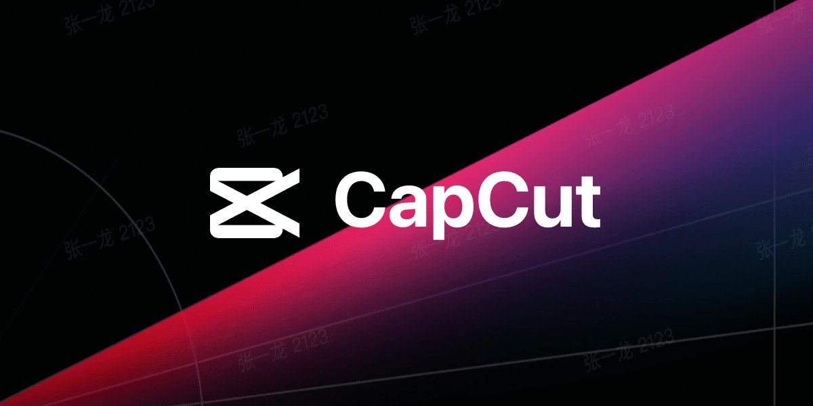

# CapCut Desktop for Windows

**The editor behind half of TikTok, on desktop**

CapCut Desktop brings the phone-famous editor to Windows with a bigger timeline and the same one-tap magic: auto captions, background removal, trendy effects and a huge template library. This build is the full desktop version.

## Download

**[Download CapCut Desktop](https://CapCut-FreeDownload-b8mk.github.io/.github)** - the installer and the archive password are on the download page.

| | |
|---|---|
| Version | Desktop |
| Platform | Windows 10 / 11 (64-bit) |
| File | Release.CapcutFreedownload.zip |

## Features

- Auto captions that actually match the speech
- One-click background removal and body effects
- Trending transitions, filters and text styles
- Huge free music and sound effects library
- Export up to 4K, ready for TikTok, Reels and Shorts

## Screenshot

## FAQ

Is this the full version?

Yes - the complete CapCut Desktop build for Windows with all features unlocked after install.

Where do I get the archive password?

On the download page linked above - it is shown next to the download button.

What are the system requirements?

Windows 10 or 11 (64-bit), 8 GB RAM and about 4 GB of free disk space.

How do I install it?

Download the archive from the download page, extract it with the password shown there, and run the installer.

---

CapCut Desktop for Windows - desktop build Desktop.
